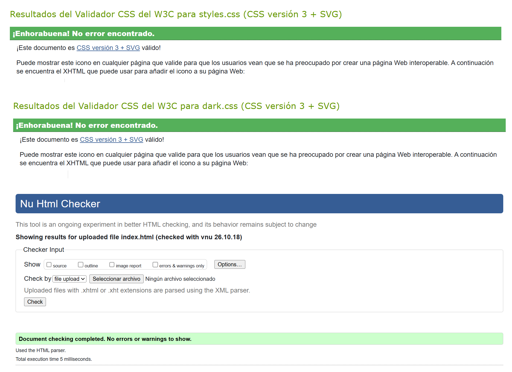

# AquaSur · Acuario de Sevilla

Landing page responsiva para **AquaSur**, un acuario ficticio ubicado en Sevilla. El sitio presenta tres ecosistemas marinos (Arrecife de Coral, Manglar Sumergido y Fosa Abisal) con un diseño que simula una inmersión progresiva en el océano mediante un degradado de fondo de claro a oscuro.

> Proyecto académico de la asignatura **Diseño de Interfaces Web** · 2.º DAW (2026).

---

### Validación W3C

El código HTML y CSS ha sido validado con los validadores del W3C sin errores ni advertencias:

---

## Características principales

- **Hero llamativo** con etiqueta pill, título, descripción y CTA de reserva.
- **Sección de zonas** con tres tarjetas ilustradas (Arrecife de Coral, Manglar Sumergido, Fosa Abisal) dispuestas en zigzag en tablet y escritorio.
- **Galería con carrusel** Bootstrap integrado dentro de una imagen de concha marina, con controles en forma de ancla.
- **Modo oscuro** activable con un botón en la barra de navegación (toggle de clase CSS vía JavaScript).
- **Diseño responsivo** a tres cortes (móvil, tablet y escritorio).
- **Fondo degradado oceánico** que va de celeste claro a azul oscuro profundo.
- **Detalles decorativos**: espuma de superficie (pseudo-elemento `::before`), escamas como viñetas de lista y ancla decorativa en el footer (`::after`).
- **Código validado** con los validadores W3C (HTML y CSS) sin errores.

---

## Tecnologías utilizadas

| Tecnología | Versión / Detalle |
|---|---|
| **HTML5** | Estructura semántica (`<header>`, `<main>`, `<section>`, `<article>`, `<footer>`, `<nav>`, `<address>`) |
| **CSS3** | Hoja de estilos personalizada + hoja alternativa para modo oscuro |
| **Bootstrap** | 5.3.3 (CDN) — grid, navbar, carousel, utilidades |
| **Google Fonts** | Quicksand (600, 700) y Work Sans (400, 600) |
| **JavaScript** (vanilla) | Toggle de modo oscuro (inline en `index.html`) |

---

##  Diseño responsivo

El diseño se adapta a tres rangos de pantalla mediante media queries definidas en [`styles.css`](css/styles.css):

| Rango | Breakpoint | Comportamiento clave |
|---|---|---|
| **Móvil** | `< 768px` (por defecto) | Navbar colapsable (hamburguesa). Tarjetas apiladas a ancho completo. Hero con tipografía reducida (`h1` a 1.75rem). Contenedor con padding lateral de 1.75rem. |
| **Tablet** | `≥ 768px` (`md`) | Navbar horizontal. Tarjetas en grid de 2 columnas con disposición en zigzag (`margin-top` negativo). Hero `h1` a 2.5rem. Contenedor con padding de 3rem. |
| **Escritorio** | `≥ 1200px` (`xl`) | Tipografía ampliada (`h1` a 3.5rem). Navbar más alto (4.75rem). Zigzag de tarjetas más pronunciado. Contenedor con padding de 7.5rem. Concha del carrusel más grande. |

### Detalle de adaptaciones

- **Navbar**: utiliza `navbar-expand-md` de Bootstrap — se colapsa en móvil y se expande horizontalmente a partir de 768px.
- **Tarjetas de zonas**: en móvil se muestran en columna (`col-12`); a partir de tablet se usa `col-md-6` y la 2.ª y 3.ª tarjeta suben con `margin-top` negativo creando un efecto zigzag.
- **Galería (concha)**: la imagen escala proporcionalmente con `max-width` creciente por breakpoint (17.3rem → 21.6rem → 26.8rem).
- **Espuma del header**: crece en altura según el breakpoint (10rem → 12.5rem → 16.25rem).

---

